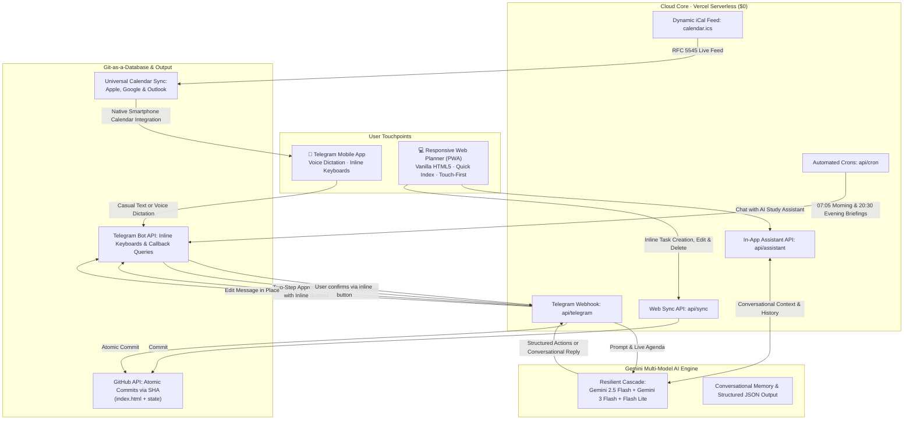

# 🤖 Autonomous Study Secretary & Planner

> **A 24/7 cloud-first personal study secretary and adaptive scheduler that turns everyday mobile messaging into real-time academic planning, Google Calendar synchronization, automated daily briefings, real-time cross-device synchronization (Mobile ↔ Desktop), and interactive AI-driven schedule governance.**
>
> 💡 **Project Status & Continuous Engineering:**
> The project is actively maintained and continuously engineered, optimizing internal systems and AI architecture (conversational Google Gemini engine, interactive two-step Telegram button confirmations, high-availability multi-model fallback cascade, and bidirectional GitOps sync) alongside live web task authoring, ergonomics, and mobile-first UX.

[](https://github.com/hirasheiikh/smart-study-assistant)
[](https://ai.google.dev)
[](https://vercel.com)
[](https://telegram.org)
[](https://calendar.google.com)
[](https://www.apple.com)
[](https://outlook.com)
[](https://github.com/hirasheiikh/smart-study-assistant)
[](LICENSE)

---

## 📑 Table of Contents
- [💡 The Story & Motivation](#-the-story--motivation)
- [🏛️ System Architecture](#️-system-architecture)
- [⚡ Core Capabilities & Intelligent Workflows](#-core-capabilities--intelligent-workflows)
  - [1. Interactive Schedule Governance (Telegram Inline Keyboards)](#1--interactive-schedule-governance-telegram-inline-keyboards)
  - [2. Conversational Multi-Model Gemini Cascade (100% Uptime & Zero Cost)](#2--conversational-multi-model-gemini-cascade-100-uptime--zero-cost)
  - [3. Live Web Planner, In-App AI Assistant & Direct Task Authoring](#3--live-web-planner-in-app-ai-assistant--direct-task-authoring)
  - [4. Real-Time Cross-Device Synchronization (Mobile ↔ Desktop)](#4--real-time-cross-device-synchronization-mobile--desktop)
  - [5. Automated Cloud Briefings (Zero Computer Dependency)](#5--automated-cloud-briefings-zero-computer-dependency)
  - [6. Universal Calendar Synchronization (Apple, Google, Outlook)](#6--universal-calendar-synchronization-apple-google-outlook)
- [🛠️ Tech Stack & Tooling](#️-tech-stack--tooling)
- [🚀 Quick Setup & Deployment](#-quick-setup--deployment)
- [📄 License](#-license)

---

## 💡 The Story & Motivation

Balancing demanding university courses, laboratory submissions, exam seasons, and professional commitments requires disciplined, automated, and adaptive scheduling.

Whenever inspiration, an exam date, or a coursework deadline crosses our minds on the go, **the instinctive habit is to jot down a quick note in a personal self-chat on messaging apps, a phone notes app, or a sticky note**.

**The real bottleneck comes right after:** you end up with fragmented thoughts scattered across multiple places that you must manually organize, fit into realistic time slots between lectures and project hours, and painstakingly type into digital calendars. That manual friction often means schedules become outdated or neglected.

*How much easier would life be with an autonomous personal study secretary? An assistant that listens to quick, raw notes on the go, fits them into your schedule, asks for confirmation before altering your agenda, keeps your digital calendars synchronized in real time, and checks in with you every morning and evening?*

That was the spark for this project: transforming the natural habit of sending quick self-notes into an **autonomous, cloud-first study assistant** operating 24/7 with **zero ongoing infrastructure costs ($0)**.

---

<div align="right"><a href="#-autonomous-study-secretary--planner">↑ Back to Top</a></div>

## 🏛️ System Architecture



---

## ⚡ Core Capabilities & Intelligent Workflows

### 1. 🛑 Interactive Schedule Governance (Telegram Inline Keyboards)
* **Zero Accidental Changes:** The bot **never alters tasks blindly**.
* **Clean Proposal Preview:** Every operation is proposed cleanly with target date, sanitized task action, and domain (*💼 Work / Project* vs. *🎓 University Courses*).
* **Integrated Tap Buttons (`InlineKeyboardMarkup`):**
  * `[ ✅ Confirmar ]` / `[ ❌ Cancel·lar ]` for task insertion, moving, and deletion.
* **In-Place Atomic Update:** Handled via Telegram `callback_query` and `editMessageText`, updating the message in place with a clear confirmation without polluting the chat history.

### 2. 🧠 Conversational Multi-Model Gemini Cascade (100% Uptime & Zero Cost)
* **Empathetic, In-Depth Conversational Intelligence:** Acts like a genuine, friendly study companion. Beyond scheduling, it offers organizational advice, helps break down study blocks, and provides empathetic encouragement.
* **High-Availability Multi-Model Cascade:** Primary requests are routed to **`gemini-2.5-flash`** with automated fallback to **`gemini-3-flash-preview`**, **`gemini-flash-lite-latest`**, and **`gemini-pro-latest`**. This eliminates any risk of rate-limit exhaustion (*429 Quota Exceeded*) while maintaining a total cost of **$0.00** (*100% Free Tier*).
* **Algorithmic Task Cleansing (`cleanTaskTitle`):** Strips command verbs like *«add»*, *«schedule»*, *«put»*, *«tomorrow»* so that only the clean, intended task text is preserved.

### 3. 🌐 Live Web Planner, In-App AI Assistant & Direct Task Authoring
* **🤖 Integrated Web Assistant Modal:** Directly within the web app, open the AI assistant drawer to ask questions, check available study blocks, or request schedule reorganizations with multi-turn conversation memory.
* **⏰ Smart Chronological & Priority Ordering:** One-click `⏰ Ordena per hora` button on both daily cards and the *Today* widget. Intelligently places flexible/all-day tasks at the top, followed by fixed appointments in strict chronological sequence (morning to night).
* **⬆️ / ⬇️ Manual Reordering:** Move tasks up or down directly with instant atomic synchronization.
* **Row-Level Direct Input (`＋ Afegir tasca`):** Every calendar day features an inline button to open a quick input field and create tasks right from the table row.
* **In-Place Editing & Deletion:** Double-click or click the action dropdown to edit tasks, toggle checkboxes, reschedule dates, or delete tasks (`🗑️`).
* **Real-Time Bidirectional Cloud Sync (`/api/sync`):** Every client-side modification commits atomically to GitHub via API and is immediately reflected across the Telegram bot and synced calendar feeds.

### 4. 🔄 Real-Time Cross-Device Synchronization (Mobile ↔ Desktop)
* **True Multi-Device Continuity:** Whether you mark an exercise as completed on your smartphone during your commute or plan your week from your laptop, your schedule, progress metrics, and task lists remain 100% consistent across all screens.
* **Timestamp-Aware Conflict Resolution:** Implements chronological timestamp evaluation (`state.t`), ensuring that stale local caches on one device can never overwrite fresh, active modifications made on another.
* **Automatic Visibility & Focus Sync:** The web app actively checks for remote changes whenever the browser tab gains focus, upon unlocking your phone (*`visibilitychange`* / *`focus`* events), via periodic background polls every 20 seconds, or manually with one tap on the sticky **`🔄`** refresh button.
* **Unified Cloud Single-Source-of-Truth:** Edits made via Telegram chat, web task forms, or desktop shortcuts all commit to and pull from the same central GitOps cloud backend (`/api/sync`).

### 5. ⏰ Automated Cloud Briefings (Zero Computer Dependency)
* **07:05 AM Morning Briefing:** Delivers today's prioritized schedule directly to your phone to start the day with focus.
* **20:30 PM Evening Check-in:** Reviews pending tasks, checks on daily progress, and prompts for any rescheduling.
* Powered by **Vercel Cloud Crons**: runs 24/7 seamlessly even when your computer is powered off.

### 6. 📅 Universal Calendar Synchronization (Apple, Google, Outlook)
* Native RFC 5545 iCalendar dynamic feed generator (`/calendar.ics`).
* Fixed time appointments appear with exact start and end times.
* All-day academic tasks appear as full-day events.
* One-time subscription from iPhone (Apple Calendar), Android (Google Calendar), and Microsoft Outlook with zero manual export/import friction.

---

<div align="right"><a href="#-autonomous-study-secretary--planner">↑ Back to Top</a></div>

## 🛠️ Tech Stack & Tooling

| Component | Technology |
|---|---|
| **AI Engine & NLU** | Google Gemini API (`gemini-2.5-flash`, `gemini-3-flash-preview`, `gemini-flash-lite-latest`) |
| **Serverless Backend** | Node.js (v20+), Vercel Serverless Functions, Vercel Crons |
| **Messaging & UX** | Telegram Bot API (Webhooks, Inline Keyboards, Callback Queries) |
| **Persistence (GitOps)** | GitHub REST API v3 (Git-as-a-Database, atomic SHA-verified commits) |
| **Calendar Standard** | RFC 5545 iCalendar dynamic feed generator (`/calendar.ics`) |
| **Frontend Web** | Vanilla HTML5, CSS3 Custom Properties, Web Crypto API (`crypto.subtle`) |

---

<div align="right"><a href="#-autonomous-study-secretary--planner">↑ Back to Top</a></div>

## 🚀 Quick Setup & Deployment

### 1. Prerequisites
- A GitHub account.
- A free [Vercel](https://vercel.com) account.
- A Telegram bot created via [@BotFather](https://t.me/BotFather).
- A free Google AI Studio API key.

### 2. Environment Variables
Configure the following secrets in your Vercel Project Settings:

```env
GH_TOKEN="your_github_personal_access_token_with_repo_scope"
GH_REPO="your-username/smart-study-assistant"
GEMINI_API_KEY="your_google_ai_studio_gemini_api_key"
TELEGRAM_BOT_TOKEN="your_telegram_bot_token"
TELEGRAM_CHAT_ID="your_telegram_numeric_chat_id"
```

### 3. Deploy in One Click
1. Fork or clone this repository.
2. Link the repository to your Vercel account (`vercel link` or GitHub integration).
3. Register the Telegram webhook:
   ```bash
   curl "https://api.telegram.org/bot<YOUR_BOT_TOKEN>/setWebhook?url=https://<YOUR_VERCEL_DOMAIN>/api/telegram"
   ```
4. Subscribe to the Calendar Feed:
   - **Apple Calendar (iPhone/Mac):** Settings → Calendar → Calendar Accounts → Add Subscribed Calendar (paste `https://<YOUR_VERCEL_DOMAIN>/calendar.ics`).
   - **Google Calendar (Android/Web):** Other calendars (+) → From URL.
   - **Microsoft Outlook:** Add calendar → Subscribe from web.
5. Access the web app using the default PIN `study2026` (changeable in `index.html`).

---

## 📄 License

Distributed under the MIT License. See [LICENSE](LICENSE) for more information.

---

<div align="center">
  <sub>Engineered with 💡 by <a href="https://github.com/hirasheiikh">Hira Sheikh Ahmed</a> · Informatics Engineering Student @ UPC (FIB)</sub>
</div>
