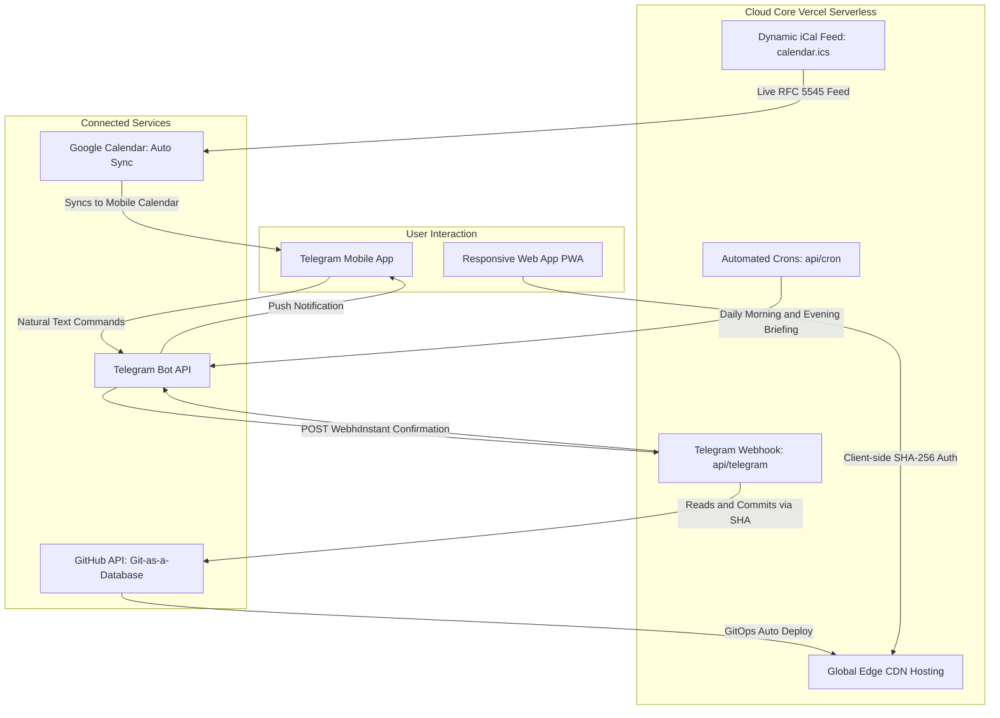

# 🤖 Autonomous Study Secretary & Planner

> **A 24/7 cloud-first personal study secretary and adaptive scheduler that turns everyday mobile messaging into real-time academic planning, Google Calendar synchronization, and automated daily briefings.**

[](https://vercel.com)
[](https://telegram.org)
[](https://calendar.google.com)
[](LICENSE)

---

## 💡 The Story & Motivation

As an Informatics Engineering student balancing university finals and an industrial AI/QA validation internship, staying on top of coursework, exams, and project submissions requires disciplined scheduling.

Like many people who rely on digital tools, whenever inspiration or a deadline crossed my mind on the go, **my instinctive habit was to send a quick note to my personal WhatsApp self-chat**. We all do it! But notes get scattered, plans drift out of date, and manual calendar management becomes another cognitive burden.

I asked myself: ***"How much easier would life be with a personal secretary who listens to quick mobile messages, maintains my schedule, automatically synchronizes my Google Calendar, and checks in on me every morning and evening?"***

That was the spark for this project: transforming the natural habit of sending quick self-notes into an **autonomous, cloud-first study assistant** operating 24/7 with **zero ongoing infrastructure costs**.

---

## 🏛️ System Architecture



---

## ✨ Full Feature Set

1. **💬 Mobile Assistant via Telegram (24/7 Bi-directional):**
   - Natural text commands: `done with PAR lab`, `move BD review to tomorrow`, or task numbers (`feta la 2`).
   - The bot matches the task, updates the state file in GitHub via API, triggers continuous deployment, and replies within seconds.
   - Type `today` or `tomorrow` anytime for an immediate, numbered schedule.

2. **⏰ Automated Cloud Briefings (Zero Computer Dependency):**
   - **07:05 AM Morning Briefing:** Delivers today's prioritized schedule and highlights any carry-over items from yesterday.
   - **21:30 PM Evening Check-in:** Reviews what was on today's agenda, asks what got completed, and prompts for any rescheduling.
   - Powered by **Vercel Cloud Crons**: runs seamlessly even if your laptop is powered off.

3. **📅 Live Google Calendar Synchronization:**
   - Exposes a live, dynamic RFC 5545 iCalendar feed (`/calendar.ics`).
   - Subscribe once in Google Calendar (`From URL`) and all exam dates, submission deadlines, and review sessions stay continuously in sync across mobile and desktop.

4. **🔒 Private & Secure Progressive Web App (PWA):**
   - Single-Page Application (SPA) with progress tracking, interactive checkboxes, task rescheduling (`⏩`), and real-time state persistence.
   - Client-side cryptographic authorization (SHA-256) with local session persistence ("Remember me on this device").
   - Git-as-a-Database: the source repository remains 100% private, with full audit trail across commits.

---

## 🛠️ Tech Stack & Tooling

- **Backend & Cloud:** Node.js (v20+), Vercel Serverless Functions, Vercel Crons.
- **Messaging:** Telegram Bot API (Webhooks & BotFather).
- **Calendar:** RFC 5545 iCalendar (iCal) dynamic feed generator, Google Calendar URL Subscription.
- **Storage & CI/CD:** GitHub REST API (v3), GitOps continuous deployment.
- **Frontend:** Vanilla HTML5, CSS3 Custom Properties, ES6+ Web Crypto API (`crypto.subtle`), LocalStorage API.

---

## 🚀 Quick Setup & Deployment

### 1. Prerequisites
- A GitHub account.
- A free [Vercel](https://vercel.com) account.
- A Telegram bot created via [@BotFather](https://t.me/BotFather).

### 2. Environment Variables
Configure the following secrets in your Vercel Project Settings:

```env
TELEGRAM_BOT_TOKEN="your_telegram_bot_token"
TELEGRAM_CHAT_ID="your_telegram_numeric_chat_id"
GH_TOKEN="your_github_personal_access_token_with_repo_scope"
```

### 3. Deploy in One Click
1. Fork or clone this repository.
2. Link the repository to your Vercel account.
3. Register the Telegram webhook:
   ```bash
   curl "https://api.telegram.org/bot<YOUR_BOT_TOKEN>/setWebhook?url=https://<YOUR_VERCEL_DOMAIN>/api/telegram"
   ```
4. Subscribe in Google Calendar:
   - Go to Google Calendar → **Other calendars (+)** → **From URL**.
   - Paste `https://<YOUR_VERCEL_DOMAIN>/calendar.ics`.
5. Done! Your autonomous study assistant is live.

---

## 📄 License

Distributed under the MIT License. See [LICENSE](LICENSE) for more information.

---

<div align="center">
  <sub>Created with 💡 by <a href="https://github.com/hirasheiikh">Hira Sheikh Ahmed</a> · Informatics Engineering Student @ UPC (FIB)</sub>
</div>