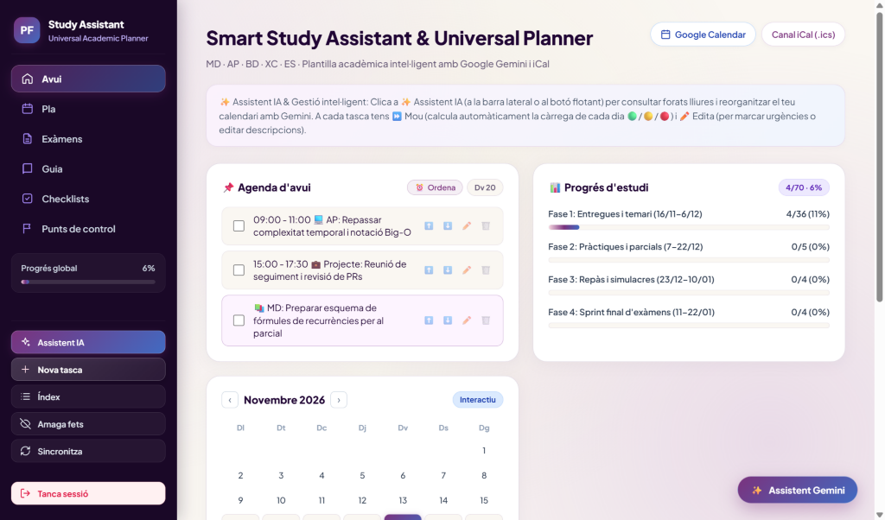
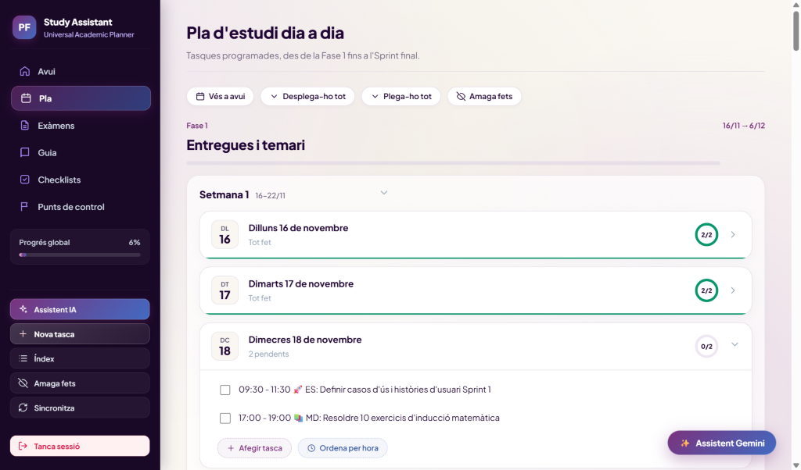
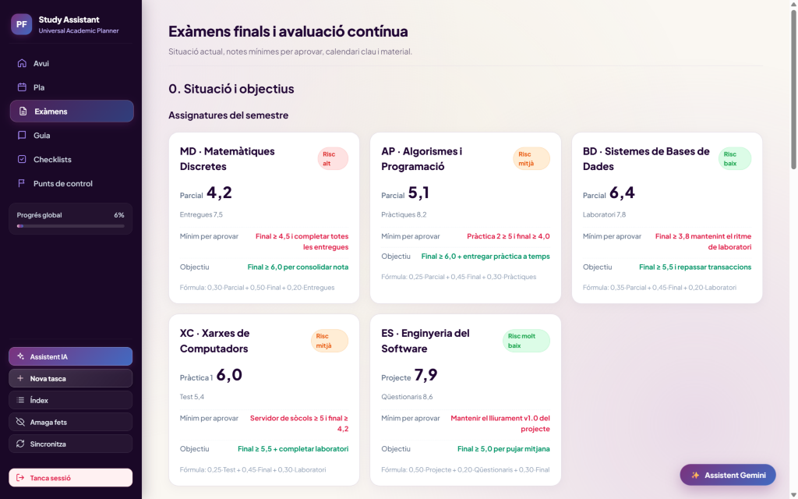
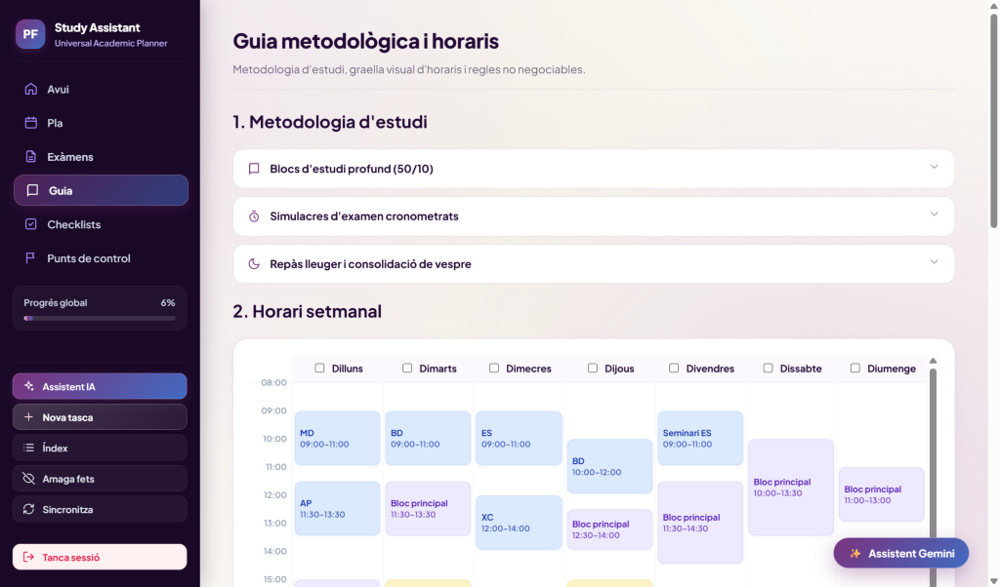
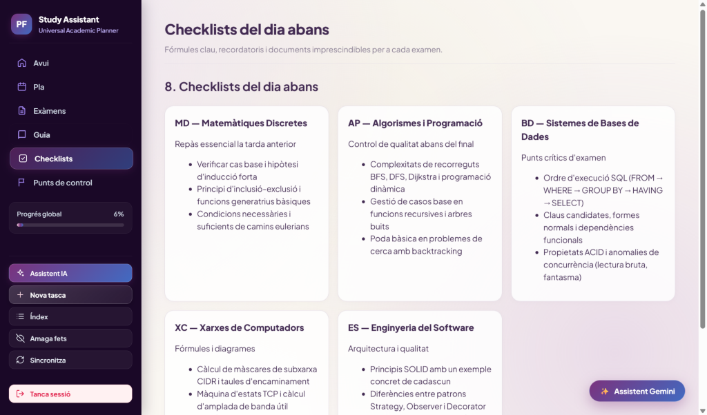
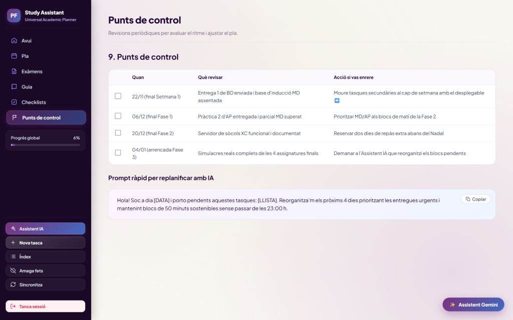
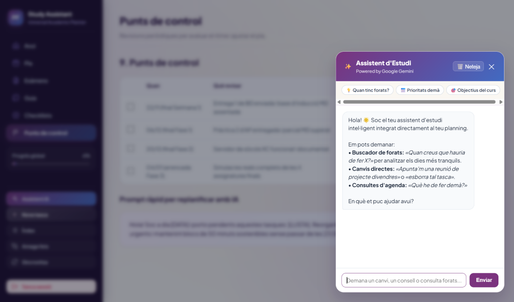
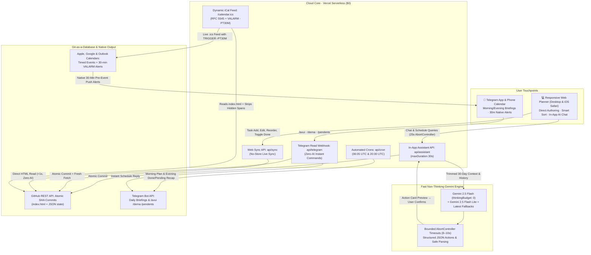

# 🤖 Autonomous Study Secretary & Planner

> **A 24/7 cloud-first personal study secretary and adaptive scheduler featuring a fast non-thinking Gemini web assistant (~2–3s response time), real-time cross-device synchronization (Mobile ↔ Desktop), automated Telegram daily briefings with instant zero-AI quick checks, and universal Calendar sync with native 30-minute `VALARM` alerts.**
>
> 💡 **Project Status & Continuous Engineering:**
> Actively maintained open-source template built for zero ongoing infrastructure cost ($0 free tier): low-latency Gemini 2.5 Flash (`thinkingBudget: 0`) with bounded `AbortController` failovers, iOS Safari keyboard-safe drawer ergonomics, atomic GitOps persistence, automated morning/evening Telegram digests, and RFC 5545 `VALARM` calendar notifications.

[](https://github.com/hirasheiikh/smart-study-assistant)
[](https://ai.google.dev)
[](https://vercel.com)
[](https://telegram.org)
[](https://calendar.google.com)
[](https://www.apple.com)
[](https://outlook.com)
[](https://github.com/hirasheiikh/smart-study-assistant)
[](LICENSE)

---

## 📑 Table of Contents
- [📸 Visual Preview (Screenshots)](#-visual-preview-screenshots)
- [💡 The Story & Motivation](#-the-story--motivation)
- [🏛️ System Architecture](#️-system-architecture)
- [⚡ Core Capabilities & Intelligent Workflows](#-core-capabilities--intelligent-workflows)
  - [1. Fast Non-Thinking In-App AI Assistant (Two-Step Approval)](#1--fast-non-thinking-in-app-ai-assistant-two-step-approval)
  - [2. Live Web Planner & Direct Task Authoring (Mobile-First)](#2--live-web-planner--direct-task-authoring-mobile-first)
  - [3. Real-Time Cross-Device Synchronization (Mobile ↔ Desktop)](#3--real-time-cross-device-synchronization-mobile--desktop)
  - [4. Streamlined Telegram Briefings & Instant Zero-AI Commands](#4--streamlined-telegram-briefings--instant-zero-ai-commands)
  - [5. Universal Calendar Sync with Native 30-Min `VALARM` Alerts](#5--universal-calendar-sync-with-native-30-min-valarm-alerts)
  - [6. Design Choice: Why Telegram + Native Calendar Alerts instead of Web Push?](#6--design-choice-why-telegram--native-calendar-alerts-instead-of-web-push)
- [🛠️ Tech Stack & Tooling](#️-tech-stack--tooling)
- [🎨 Customization (Language, Colors, Subjects & PIN)](#-customization-language-colors-subjects--pin)
- [🚀 Quick Setup & Deployment](#-quick-setup--deployment)
- [📄 License](#-license)

---

## 📸 Visual Preview (Screenshots)

> [!NOTE]
> **Language & Full Customizability:** This public template comes written in **Catalan** by default (`<html lang="ca">`, UI labels, sample academic plan, Telegram briefings, and Gemini assistant prompts). Everything lives inside clean, self-contained HTML/CSS/JS files so **you can easily translate it into any language** (English, Spanish, French, etc.) and **customize the color palette, subjects, schedule, and PIN** to your liking—see [Customization](#-customization-language-colors-subjects--pin) below.

### Today Dashboard (`Avui`)


### All Planner Views & AI Assistant
| Daily Study Plan (`Pla`) | Exams & Risk Overview (`Exàmens`) |
| :---: | :---: |
|  |  |

| Methodology & Timetable Grid (`Guia`) | Day-Before Checklists (`Checklists`) |
| :---: | :---: |
|  |  |

| Control Checkpoints & AI Prompt (`Punts de control`) | In-App Gemini Assistant Drawer |
| :---: | :---: |
|  |  |

---

## 💡 The Story & Motivation

Balancing demanding university courses, laboratory submissions, exam seasons, and personal or work commitments requires disciplined, flexible scheduling.

Whenever an exam date, deadline, or task comes to mind on the go, **fragmented notes in chats or sticky apps quickly drift out of sync with your actual calendar**. Meanwhile, bloated planner apps either require paid subscriptions or lock your schedule inside proprietary databases.

*How much simpler would life be with an open-source, self-hosted study planner that keeps your week cleanly organized across desktop and mobile, lets you chat with a fast AI assistant right inside the web app to find free slots and reorganize days, sends concise morning and evening briefings to Telegram, and pushes native 30-minute reminders through your smartphone's own Calendar app?*

This template provides that complete **cloud-first study planner & assistant** operating 24/7 with **zero ongoing infrastructure costs ($0)**.

---

<div align="right"><a href="#-autonomous-study-secretary--planner">↑ Back to Top</a></div>

## 🏛️ System Architecture



---

## ⚡ Core Capabilities & Intelligent Workflows

### 1. 🧠 Fast Non-Thinking In-App AI Assistant (Two-Step Approval)
* **Eliminates Thinking-Mode Delays (~2–3s Responses):** Gemini 2.5 models enable deep multi-step reasoning by default, which can cause HTTP timeouts on serverless endpoints. `api/assistant.js` sets `thinkingConfig: { thinkingBudget: 0 }` on `gemini-2.5-flash` and `gemini-2.5-flash-lite` so answers return in ~2–3 seconds instead of hanging.
* **Bounded Failover & Timeouts:** Each model candidate uses a dedicated `AbortController` (`8s–10s` per model, immediately switching on non-200 or abort without sleep delays), backed by a `25s` client-side `AbortController` with double-click lock and clear error feedback.
* **Zero Accidental Edits (Two-Step Action Cards):** Asking the assistant to add, move, edit, or delete tasks renders a structured preview card inside the chat. Changes only commit to GitHub when you click **«Aplica els canvis»**.
* **Mobile iOS Keyboard-Safe UI:** The assistant drawer sets `font-size: 16px` on mobile inputs (preventing Safari auto-zoom), hides the underlying `#root` cleanly while open (`visibility: hidden`), and binds height/offset to `window.visualViewport` so the input bar stays docked right above the virtual keyboard.

### 2. 🌐 Live Web Planner & Direct Task Authoring (Mobile-First)
* **⏰ Smart Chronological & Priority Ordering:** One-click `⏰ Ordena per hora` button on daily cards and the *Today* widget keeps flexible tasks at the top and sorts timed appointments chronologically from morning to night.
* **⬆️ / ⬇️ Manual Reordering & Direct Inline Editing:** Reorder tasks seamlessly, toggle completion checkboxes, add tasks directly on any day row, edit text inline, or delete tasks (`🗑️`).
* **🔖 Instant Quick Index:** Floating/toolbar section index to jump directly to Today's schedule, subjects, weekly calendar, key deadlines, or finals table.

### 3. 🔄 Real-Time Cross-Device Synchronization (Mobile ↔ Desktop)
* **Git-as-a-Database Single Source of Truth (`/api/sync`):** Every task edit, completion toggle, and AI action writes atomically to `index.html` via the GitHub API and reads back with `cache: 'no-store'`.
* **Proper `<template>` DOM Refresh:** Uses `DocumentFragment` (`tpl.content.replaceChildren(...)`) so remote task additions/removals from another device reflect immediately on render, plus timestamp-aware conflict resolution (`state.t`) and clean sync spinner cleanup.

### 4. 🤖 Streamlined Telegram Briefings & Instant Zero-AI Commands
* **Clean Daily Focus (`api/cron.js`):**
  * **Morning Briefing:** Lists any uncompleted tasks carried over from yesterday plus today's full plan, with a direct link to the web planner.
  * **Evening Recap:** Calculates daily progress (`✅ Fet avui` vs. `⏳ Pendent d'avui`) in separate, scannable sections and links straight to the web planner for one-tap rescheduling.
* **Instant Zero-AI Bot Webhook (`api/telegram.js`):** Telegram avoids slow AI roundtrips altogether and responds in under a second to deterministic read commands:
  * `/avui` — Live checklist of today's tasks.
  * `/dema` — Preview tomorrow's schedule.
  * `/pendents` — All overdue + remaining tasks up to today.
  * Any other message politely directs you to the fast in-app web AI assistant.

### 5. 📅 Universal Calendar Sync with Native 30-Min `VALARM` Alerts
* Dynamic RFC 5545 iCalendar feed at `/calendar.ics` (`api/calendar.js`).
* Timed tasks and exams automatically include a **`BEGIN:VALARM`** block with **`TRIGGER:-PT30M`** (`ACTION:DISPLAY`) so your phone notifies you natively **30 minutes before** scheduled sessions, calls, labs, or exams.
* Clean titles (strips hidden `<span class="cal-sync">` markers), full timed ranges (`HH:MM - HH:MM`), `15-minute` refresh hint (`REFRESH-INTERVAL;VALUE=DURATION:PT15M`), and compatibility across Apple Calendar, Google Calendar, and Outlook.

> 💡 **iPhone / Apple Calendar Tip:** Open **Calendar → Calendars → tap `ⓘ`** next to your subscribed planner calendar and make sure **«Ignore Alerts»** is switched **OFF** so iOS delivers the 30-minute `VALARM` notifications automatically.

### 6. 📱 Design Choice: Why Telegram + Native Calendar Alerts instead of Web Push?
True iOS Web Push notifications require installing the app via *«Add to Home Screen»* (PWA mode only), managing Service Workers, configuring VAPID keys, and maintaining an external database for device push tokens. By combining **Telegram scheduled morning/evening briefings + native `.ics` `VALARM` 30-minute alerts**, you get identical push notifications directly on iOS/Android lock screens with higher reliability and zero extra database infrastructure.

---

<div align="right"><a href="#-autonomous-study-secretary--planner">↑ Back to Top</a></div>

## 🛠️ Tech Stack & Tooling

| Component | Technology |
|---|---|
| **AI Engine & NLU** | Google Gemini API (`gemini-2.5-flash` with `thinkingBudget: 0`, `gemini-2.5-flash-lite`, fallback cascade + `AbortController`) |
| **Serverless Backend** | Node.js (v20+), Vercel Serverless Functions (`maxDuration: 30`), Vercel Crons |
| **Messaging & Alerts** | Telegram Bot API (Scheduled Morning/Evening Briefings & Zero-AI Quick Commands) |
| **Persistence (GitOps)** | GitHub REST API v3 (Git-as-a-Database, atomic SHA-verified commits) |
| **Calendar Standard** | RFC 5545 iCalendar dynamic feed (`/calendar.ics`) with 30-min `VALARM` triggers |
| **Frontend Web** | Vanilla HTML5, CSS3 Custom Properties, `visualViewport` Mobile Chat UX, Web Crypto API |

---

<div align="right"><a href="#-autonomous-study-secretary--planner">↑ Back to Top</a></div>

## 🎨 Customization (Language, Colors, Subjects & PIN)

This template is designed to be adapted effortlessly without any build tools or framework overhead:

### 🌐 Language (Default: Catalan)
- The default UI, sample curriculum, AI assistant responses, and Telegram messages are in **Catalan**.
- To switch to your preferred language:
  - **`index.html`:** Update `<html lang="ca">`, `MONTH_NAMES`, `DAY_NAMES`, `VIEW_META`, UI labels/buttons inside `<script id="app">`, and the sample sections inside `<template id="content">`.
  - **`api/assistant.js`:** Adjust the Gemini system prompt (`ca-ES` date formatting and reply language instructions).
  - **`api/cron.js` & `api/telegram.js`:** Translate the morning/evening digest templates and bot commands (`/avui`, `/dema`, `/pendents`).

### 🎨 Colors & Visual Theme
Edit the CSS custom properties at the top of `<style id="css">` in `index.html`:

```css
:root {
  --primary: #7B337E;          /* Accent purple */
  --primary-dark: #210635;     /* Deep heading & text accent */
  --primary-sapphire: #426bc2; /* Secondary blue accent */
  --primary-light: #F5D5E0;    /* Soft highlight */
  --bg-page: #FAF7F2;          /* Warm page canvas */
  --fg: #210635;               /* Main text color */
  --ok: #059669;               /* Completed / low-risk green */
  --late: #f43f5e;             /* Overdue / high-risk alert */
}
#bar { background: #1a0827; }  /* Sidebar background */
```

### 📚 Subjects, Timetable & Tasks
- Edit `<template id="content">` in `index.html` to replace the 5 sample subjects (**MD**, **AP**, **BD**, **XC**, **ES**), exam formulas, weekly timetable grid, and `<tr data-day="YYYY-MM-DD">` daily task rows.

### 🔒 Access PIN
- Demo PIN out of the box is **`study2026`**. Update the validation in `showLogin()` / `EXPECTED_HASH` inside `index.html` before deploying your personal instance.

---

<div align="right"><a href="#-autonomous-study-secretary--planner">↑ Back to Top</a></div>

## 🚀 Quick Setup & Deployment

### 1. Prerequisites
- A GitHub account.
- A free [Vercel](https://vercel.com) account.
- A Telegram bot created via [@BotFather](https://t.me/BotFather).
- A free Google AI Studio API key.

### 2. Environment Variables
Configure the following secrets in your Vercel Project Settings:

```env
GH_TOKEN="your_github_personal_access_token_with_repo_scope"
GH_REPO="your-username/smart-study-assistant"
APP_URL="https://your-planner.vercel.app"
GEMINI_API_KEY="your_google_ai_studio_gemini_api_key"
TELEGRAM_BOT_TOKEN="your_telegram_bot_token"
TELEGRAM_CHAT_ID="your_telegram_numeric_chat_id"
```

### 3. Deploy in One Click
1. Fork or clone this repository.
2. Link the repository to your Vercel account (`vercel link` or GitHub integration).
3. Register the Telegram webhook:
   ```bash
   curl "https://api.telegram.org/bot<YOUR_BOT_TOKEN>/setWebhook?url=https://<YOUR_VERCEL_DOMAIN>/api/telegram"
   ```
4. Subscribe to the Calendar Feed:
   - **Apple Calendar (iPhone/Mac):** Settings → Calendar → Calendar Accounts → Add Subscribed Calendar (paste `https://<YOUR_VERCEL_DOMAIN>/calendar.ics`), then open Calendar → Calendars → `ⓘ` and confirm **Ignore Alerts** is off.
   - **Google Calendar (Android/Web):** Other calendars (+) → From URL.
   - **Microsoft Outlook:** Add calendar → Subscribe from web.
5. Access the web app using the default PIN `study2026` (changeable in `index.html`).

---

## 📄 License

Distributed under the MIT License. See [LICENSE](LICENSE) for more information.

---

<div align="center">
  <sub>Engineered with 💡 by <a href="https://github.com/hirasheiikh">Hira Sheikh Ahmed</a></sub>
</div>
